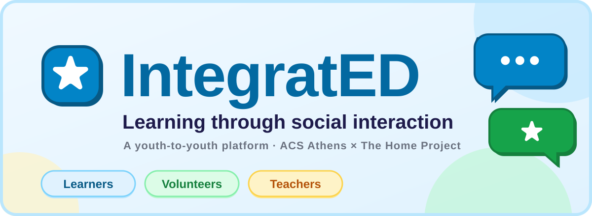
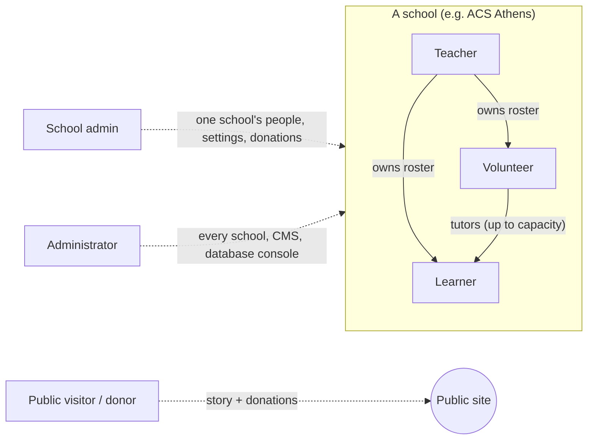
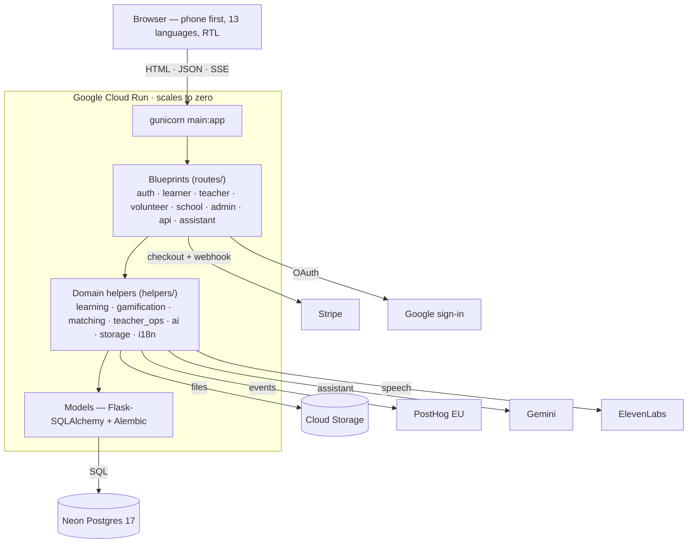

<p align="center">
  
</p>

<p align="center">
  <b>A youth-to-youth learning platform where school students tutor young refugees — and nobody has to be able to read to take part.</b>
</p>

<p align="center">
  
  
  
  
  
  <br>
  
  
</p>

<p align="center">
  <a href="https://github.com/jollyolliel/IntegratED/actions/workflows/tests.yml"></a>
  <a href="https://github.com/jollyolliel/IntegratED/actions/workflows/codeql.yml"></a>
  <a href="https://github.com/jollyolliel/IntegratED/actions/workflows/migrations.yml"></a>
</p>

<p align="center">
  <a href="#-what-is-this">About</a> ·
  <a href="#-how-it-works">How it works</a> ·
  <a href="#-features">Features</a> ·
  <a href="#-design-principles">Principles</a> ·
  <a href="#-architecture">Architecture</a> ·
  <a href="#-run-it-locally">Run it</a> ·
  <a href="#-documentation">Docs</a>
</p>

---

## 🌍 What is this?

IntegratED is run from **ACS Athens**. Secondary-school students volunteer as tutors
for young refugees from **The Home Project**. Most of those learners cannot yet read in
any language — so the app has to teach, and be usable, **without relying on text**.

The idea behind it is simple: people learn a language fastest by *using* it with
someone. Every learner is paired with a student volunteer, and the platform is the
shared space around that pair — games to play together, a path to follow, and a
teacher who can see how it's going.

## 🤝 How it works



| Role | Signs in with | Does |
|---|---|---|
| 🧒 **Learner** | username + password, via an invite code | survey, placement test, learning path, minigames, worksheets, XP and avatar |
| 🙋 **Volunteer** | Google, via an invite code | sees their learners, sessions and worksheets; fills in a survey used for matching |
| 🧑‍🏫 **Teacher** | Google (school domain) | roster, matching, attendance, worksheets, AI assistant |
| 🏫 **School admin** | username + password | one school's people, settings, donations, attendance |
| 🛠️ **Administrator** | username + password | every school and user, CMS, database console |

A **pair** is a fact about a learner (their volunteer), not a record of its own: a
learner has at most one volunteer, and a volunteer may tutor several learners.

## ✨ Features

### For learners
- **Survey and adaptive placement test** — a short staircase test per placement scale gives each learner a suggested course and starting topic.
- **Learning path** — content is *Subject → Topic → Lesson → Question*; a lesson is a quiz or one minigame.
- **Five calm minigames** — no timer, nothing lost on a wrong answer, and the answer itself is the game mechanic:

  | Game | What you do |
  |---|---|
  | 🌱 **Garden Grow** | earn water drops for right answers, then plant a seed or make it rain on a persistent jungle clearing |
  | 🧪 **Potion Workshop** | brew recipes by pouring answer bottles into a cauldron; a flawless recipe is a golden potion that doubles the next lesson's XP |
  | 🚀 **Rocket** | each right answer flies the rocket one hop along a route of moons to the home planet |
  | 🏮 **Lantern Sky** | the right lantern rises and lights a star in a constellation; the rest blow away |
  | 🚂 **Match Up** | tap a word, then its partner, to couple carriages onto a train |
- **XP, levels and an avatar** — finishing a lesson the first time earns XP; levels unlock avatar items.
- **Read-aloud everywhere** — every question has a speaker button: recorded audio, with speech synthesis as the fallback (ElevenLabs).

### For teachers
- **Roster and matching** — set priorities, run **Auto-Match**, review the proposed pairs, then approve. Match scores are always recomputed, never stored.
- **Attendance** — one register per day; one row per person per day, so learner and volunteer can disagree and absences are recorded facts.
- **Worksheets** — a library with per-learner recommendations by topic, assignable and printable as PDFs.
- **AI assistant** — ask "who missed two sessions?" or "log today's register". It *proposes*, never acts: every write is staged for the teacher to approve.

### For schools and the public
- **School admin and administrator tools** — people, settings, schools, donations, CMS (articles, team, site text) and a database console.
- **Public site** — tells the programme's story and takes donations through Stripe Checkout.

## 🎨 Design principles

1. **Design for someone who can't read.** Meaning is carried by icons, pictures, colour *and* shape, and speech. The UI is phone-first, translated into **13 languages** (English, Arabic, Greek, Spanish, Persian, French, Pashto, Somali, Swahili, Tigrinya, Turkish, Ukrainian and Rohingya) with right-to-left layouts.
2. **A visual language that can't drift.** "Clay" UI with one rule: clickable things have shadows matching their border and press into them; static things have paler shadows and never move. Colours and radii are tokens, and lint rejects pages that restyle components or use raw colours.
3. **Rosters belong to teachers.** Access is decided by ownership, not only role or school, and a hand-written authorization test walks every URL in the app.
4. **Never trust the browser's score.** The server clamps minigame results against what the lesson could have earned, and XP is granted only on first completion.
5. **An assistant that proposes, never acts.** Reads are scoped and fail closed; writes are staged for review.
6. **Built for scale-to-zero.** Cloud Run and the database sleep when idle; a sleeping database shows a self-refreshing "starting up" page instead of hanging.

The reasoning behind the hard-to-reverse choices is recorded in [`docs/adr/`](docs/adr/).

## 🏗️ Architecture

One Flask monolith. Pages are server-rendered from [jx](https://pypi.org/project/jx/) components; the interactive parts (games, attendance register, assistant panel, Auto-Match) are plain JavaScript talking to JSON endpoints.



### Tech stack

| Layer | Tech |
|---|---|
| **Web** | Flask, Flask-Login, Authlib (Google OAuth), Flask-Limiter, Flask-Compress, gunicorn |
| **UI** | jx components, Tailwind CSS, vanilla JavaScript, Baloo 2 |
| **Data** | SQLAlchemy + Alembic · Neon Postgres 17 in production, SQLite in development |
| **Hosting** | Google Cloud Run, Cloud Storage, Artifact Registry, GitHub Actions deploys |
| **Integrations** | Gemini (assistant), ElevenLabs (speech), Stripe (donations), PostHog (analytics), OpenTelemetry |
| **Documents** | fpdf2 + uharfbuzz for printable, multi-script PDFs |
| **Tooling** | [uv](https://docs.astral.sh/uv/), pytest, ruff, ty, ast-grep, CodeQL, Dependabot |

### Project layout

```text
main.py            app entry point (gunicorn main:app)
models.py          users, schools, attendance, donations, CMS
models_learning.py subjects, topics, lessons, questions, sessions
routes/            blueprints: auth, base, learner, teacher, volunteer, school, admin, api, assistant
helpers/           domain logic: learning, gamification, matching, teacher_ops, ai, storage, i18n
templates/         jx components and pages
static/            CSS, JS, SVG illustrations and minigame art
translations/      one JSON file per language
migrations/        Alembic migrations
seed/              throwaway sample data for development
tests/             unit, integration and authorization-matrix tests
docs/              system design, per-area guides and ADRs
```

## 🚀 Run it locally

You need **Python 3.15+** and [uv](https://docs.astral.sh/uv/) in the `required-version` range set in
`pyproject.toml` (`uv self update` gets you there).

```sh
cp .env.example .env      # APP_ENV=development is required
uv sync                   # install from uv.lock
uv run main.py            # http://127.0.0.1:5000
```

The first run creates a SQLite database at `instance/site.db` and a local bucket at `instance/bucket/`, both filled with throwaway sample data from `seed/`. Delete `instance/` to start over.

In development:

- `/dev/login-as?type=teacher&next=/teacher/` signs you in as any role (`learner`, `volunteer`, `teacher`, `school_admin`, `administrator`)
- "Sign in with Google" opens a local stand-in, so no Google credentials are needed
- `/dev/components` is the component gallery

## ✅ Quality checks

```sh
uv run -m pytest          # tests (use `-m pytest`, not bare `pytest`)
uv run ruff check .       # lint
uv run ty check           # types
```

CI runs all three on every pull request, plus **CodeQL** code scanning and a **migration replay on Postgres**. Pushes to `master` build a container image and deploy to Cloud Run; schema migrations and backups run as Cloud Run Jobs rather than at container start.

## 📚 Documentation

Start with [docs/system-design.md](docs/system-design.md) for the whole picture and [docs/CONTEXT.md](docs/CONTEXT.md) for the vocabulary. Each folder under `docs/` has a README that points to the one file you need:

| Area | Start at |
|---|---|
| Pages, components, CSS, copy | [docs/ui-design/](docs/ui-design/README.md) |
| Routes, permissions, models, migrations | [docs/backend/](docs/backend/README.md) |
| Placement test, learning path, minigames | [docs/learning/](docs/learning/README.md) |
| Matching, worksheets, AI assistant, attendance | [docs/features/](docs/features/README.md) |
| Deploys, CI, secrets, the production database | [docs/operations/](docs/operations/README.md) |
| Tests, conventions, translations | [docs/development/](docs/development/README.md) |
| Why things were decided | [docs/adr/](docs/adr/) |

## 🤲 Contributing

Open an issue first for anything beyond a small fix. Pull requests target `master` and need green tests and code scanning. User-facing text goes through translation keys — see [docs/development/translations.md](docs/development/translations.md).

## 🔐 Security

Please report vulnerabilities privately, never in a public issue. See [SECURITY.md](SECURITY.md).

## 📄 License

[PolyForm Noncommercial 1.0.0](LICENSE) — free to use, change and share for noncommercial purposes.

<p align="center"><sub>Built by students at ACS Athens, for young people finding their feet in a new country.</sub></p>
