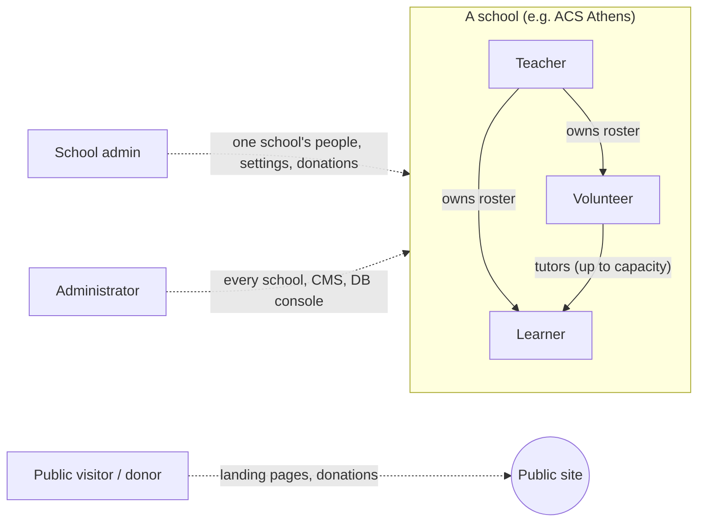
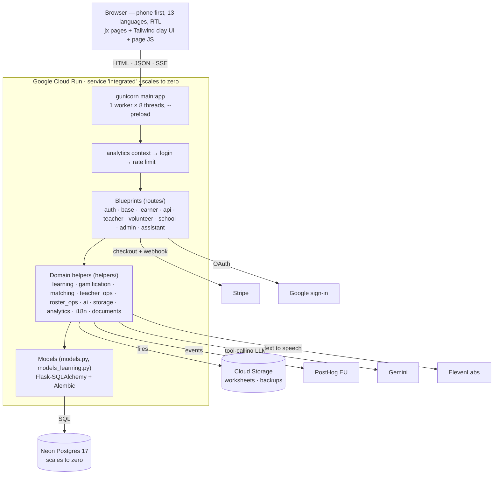
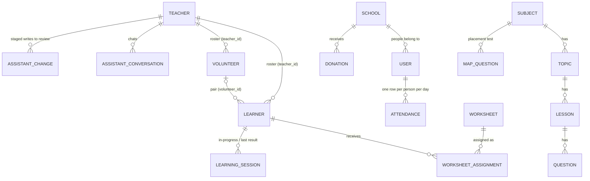
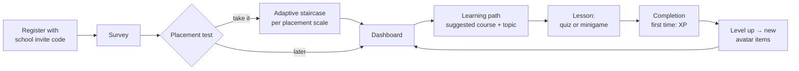
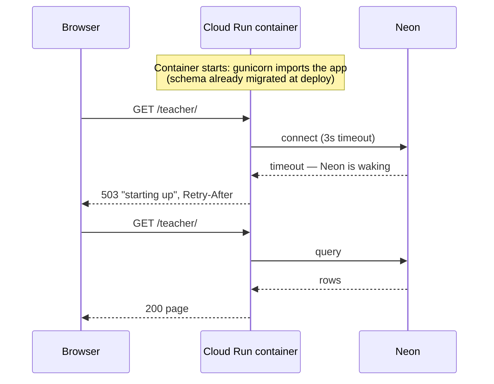
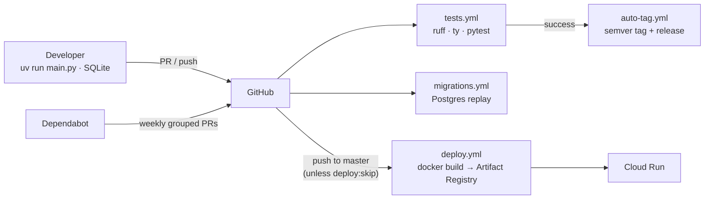

# IntegratED — system design

The whole system on one page: who it serves, how it is built, and the ideas
that hold it together. Written for people first; the folders beside this file
hold the working detail.

## What it is

IntegratED is a **youth-to-youth (Y2Y) learning platform** run from ACS Athens.
Secondary-school students volunteer as tutors for young refugees from The Home
Project. Most learners cannot yet read in any language, so the app has to teach
— and be usable — without relying on text.

Around each learner–volunteer **pair**, a school's teachers run the programme:
they build the roster, match pairs, log attendance, hand out worksheets, and
get help from an AI assistant. School admins and a global administrator run
schools, people, donations and site content. The public site tells the
programme's story and takes donations.

## People and roles

| Role | Signs in with | Does |
|---|---|---|
| Learner | username + password, via an invite code | survey, placement test, learning path, five minigames, worksheets, XP and avatar |
| Volunteer | Google, via an invite code | sees their learners, sessions and worksheets; survey for matching |
| Teacher | Google (school domain) | roster, matching, attendance, worksheets, AI assistant |
| School admin | username + password | one school's people, settings, donations, attendance |
| Administrator | username + password | every school and user, CMS, database console, impersonation |

A **pair** is a fact about a learner (their volunteer), not a record of its
own. A learner has at most one volunteer; a volunteer may hold several
learners.

## Runtime architecture

It is one Flask monolith. Pages are server-rendered from **jx components**;
the interactive parts (games, attendance register, assistant panel, Auto-Match)
are plain JavaScript on those pages talking to JSON endpoints. In development
the same app runs on SQLite with local files and seeded data.

## Domain model

`User` is specialised into the five roles by joined-table inheritance. A
learner's progress — finished lessons, placement levels, garden, equipped
avatar items, survey — lives in JSON columns on `Learner`. Content and CMS
(articles, team, site text, announcements) round it out.

## Key flows

**A learner's path**

**A teacher's week**: open the dashboard (claims new sign-ups, shows the
school invite code) → set matching priorities and run Auto-Match, review and
approve the proposed pairs → log each session's attendance on one register →
assign and print worksheets suggested for each learner's topic → ask the
assistant ("who missed two sessions?", "log today's register") and approve
the changes it stages.

**A cold request**

## The ideas that hold it together

1. **Design for someone who can't read.** Meaning is carried by icons,
   pictures, colour *and* shape, and speech; every string is translated into
   13 languages with right-to-left layouts; minigames are calm, retry-friendly
   and make the answer itself the game mechanic. → `ui-design/designing-for-learners.md`

2. **A visual language that can't drift.** Clay UI with one rule at its core —
   clickable things have shadows matching their border and press into them;
   static things have paler shadows and never move. Colours, radii and shadow
   geometry are tokens; every look is a prop on a jx component declared in one
   registry; lint rejects pages that restyle components or use raw colours; a
   gallery renders every component. (ADR 0011, 0012) → `ui-design/`

3. **Rosters belong to teachers.** Access is decided by ownership
   (`teacher_id`), not just by role or school, and every route proves the row
   it touches is the caller's. A hand-written authorization matrix test walks
   every URL in the app. → `backend/access-control.md`

4. **One set of mutations for every caller.** Matching, capacity, attendance
   and worksheet changes live in `helpers/teacher_ops`, used by the teacher's
   screens, Auto-Match and the AI assistant alike, so a rule enforced once
   holds everywhere.

5. **Record what people actually did.** Attendance is one row per person per
   day, so a learner and volunteer can disagree and absences are facts (ADR
   0001); totals therefore count learner rows only. Match scores are always
   recomputed, never stored, because they'd go stale.

6. **Never trust the browser's score.** Minigames report results, the server
   clamps them against what the lesson's questions could have earned (ADR
   0005), and XP is only granted on a first completion.

7. **An assistant that proposes, never acts.** The teacher's AI assistant reads
   through a scope derived from the foreign-key graph that fails closed, and
   every write is a hand-written operation staged for review and replayed
   through `teacher_ops` on approval. It sits behind a vendor-neutral provider
   seam. (ADR 0007, 0008) → `features/ai-assistant.md`

8. **Built for scale-to-zero.** Both Cloud Run and Neon sleep when idle. A
   booting container only serves: migrations run at deploy and backups on a
   schedule, as Cloud Run Jobs (ADR 0015). A sleeping database fails fast
   into a self-refreshing "starting up" page instead of hanging threads
   (ADR 0010). Nothing at import may wait on the database.

9. **Dev is SQLite, prod is Postgres.** Tests are fast because they run on
   in-memory SQLite; the gap (foreign keys, types, migration syntax) is
   covered by dialect-agnostic migrations and a Postgres replay in CI.

## Delivery

Labels on a PR choose the version bump and can skip a deploy; Dependabot
updates never deploy on their own. → `operations/`

## Deliberate limits

Known properties of the current design, not oversights to rediscover:

- **No CSRF tokens.** Protection rests on `SameSite=Lax` cookies, an `Origin`
  check on every write, and every state change being a POST.
- **One process per container.** Rate limits and small caches (translations) are per-process memory.
- **Deploys don't wait for tests**; a red build blocks the version tag only.
- **Backups are a daily job** that writes at most weekly, deduplicated by content hash.
- **Content is append-only by default**: the importer upserts by title and deletes only on `flask import-questions --prune --apply`.

## Where to read next

| Folder | Covers |
|---|---|
| [CONTEXT.md](CONTEXT.md) | the domain vocabulary |
| [ui-design/](ui-design/README.md) | building and designing anything a user sees |
| [backend/](backend/README.md) | routes, access control, data model, shared services |
| [learning/](learning/README.md) | the learner journey, quiz and minigames, content |
| [features/](features/README.md) | matching, worksheets, AI assistant |
| [operations/](operations/README.md) | deploying, CI, production database |
| [development/](development/README.md) | running, testing, Python conventions, translations |
| [adr/](adr/) | why the hard-to-reverse decisions went the way they did |
